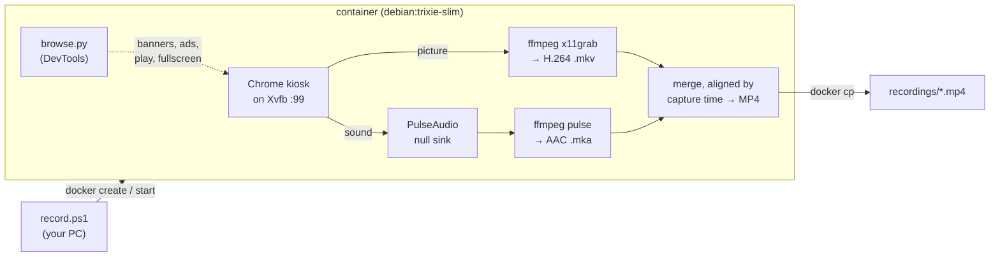

# play-action

**Record any web page, with sound, to an MP4: Chrome runs full-screen inside Docker, and you get a smooth 60 fps video file.**


[](LICENSE)

```powershell
.\record.ps1 https://www.youtube.com/watch?v=... -DurationMin 90 -Title "Interview"
```

It records a live stream, a TV player, a YouTube video or a dashboard, and you can keep using your PC while it runs. Nothing runs in your own browser.

---

## Contents

- [Features](#features)
- [Requirements](#requirements)
- [Quick start](#quick-start)
- [Options](#options)
- [What happens on the page](#what-happens-on-the-page)
- [Logged-in pages](#logged-in-pages--cookies)
- [File size and compression](#file-size-and-compression)
- [How it works](#how-it-works)
- [Using the image directly](#using-the-image-directly-docker)
- [Output](#output)
- [Known limits](#known-limits)
- [Troubleshooting](#troubleshooting)
- [License](#license)

## Features

- 🎥 **Smooth video:** 60 fps by default (`-Fps 50` for European TV). Picture and sound are captured by separate processes, so the video never stalls while the page is silent.
- 🔊 **Sound in sync:** both tracks carry their capture time and are lined up to within about 40 ms.
- 🍪 **Cookie banners closed for you:** it knows 13 common banner tools and falls back to finding a "Reject"/"Accept" button in six languages.
- ▶️ **Players started for you:** on YouTube it skips the consent screen, waits out ads, picks the original audio track, turns subtitles off, goes fullscreen and starts from 0:00. Players with a `.play-action` button (Shaka) are clicked and switched to fullscreen.
- 🔐 **Logged-in recording:** it can use cookies exported from your own browser.
- ⏱️ **Timed or open-ended:** `-Duration` (seconds), `-DurationMin` (minutes), or record until Ctrl+C. Stopping early keeps everything recorded so far.
- 🗜️ **Optional H.265:** `-Compress` makes the file 30–45 % smaller.
- 🧹 **Nothing left behind:** each run uses a fresh container, which is removed afterwards.

## Requirements

- **Docker** on an **amd64** machine; developed and tested on Windows with Docker Desktop. Chrome has no Linux arm64 build, so Apple Silicon Macs are not supported.
- **PowerShell** for `record.ps1`, either Windows PowerShell 5.1 or PowerShell 7. You can also run the image with plain `docker`, [see below](#using-the-image-directly-docker).
- Roughly **3.5 CPU cores** for 1080p at 50–60 fps.

## Quick start

```powershell
git clone https://github.com/sroziewski/play-action.git
cd play-action
Set-ExecutionPolicy -Scope CurrentUser RemoteSigned       # once, if scripts are blocked

.\record.ps1 https://example.com -Duration 30      # 30 seconds
.\record.ps1 https://example.com -DurationMin 90   # 90 minutes
.\record.ps1 https://example.com                   # until Ctrl+C
.\record.ps1 -Help                                 # full usage guide
```

The first run builds the Docker image, which takes a few minutes. After that a recording starts in seconds.

Videos are saved to `.\recordings\` under the folder you run the command from. While recording, a single status line keeps you informed:

```text
Recording https://example.com at 1920x1080 60 fps, 30 s
  REC 00:12 / 00:30  (00:18 left)
  browse: cookie banner (reject): clicked #onetrust-reject-all-handler
Saved D:\...\recordings\recording-20261023-100201-f935.mp4 (1.2 MB)
```

## Options

`.\record.ps1 -Help` (or `-h`) prints the full guide. `Get-Help .\record.ps1 -Full` gives the standard PowerShell help.

### What to record

| Option | Default | Meaning |
|---|---|---|
| `<Url>` | *(required, first argument)* | Page to open: `http://`, `https://` or `file://` |
| `-Duration <s>` | *(until Ctrl+C)* | Seconds to record, 1–86400 |
| `-DurationMin <m>` | *(until Ctrl+C)* | The same in minutes, up to 1440, fractions allowed (`1.5` = 90 s). Not together with `-Duration` |
| `-Warmup <s>` | `3` | Extra seconds to wait before recording, 0–600. They count after the page is ready (cookie banner handled, YouTube ads over) |

### Where to save

| Option | Default | Meaning |
|---|---|---|
| `-Dir <folder>` | `.\recordings` | Folder to save in, relative to the current folder or absolute; created if missing |
| `-Title <name>` | `recording-<timestamp>-<id>` | File name without extension, saved as `<Dir>\<name>.mp4` |
| `-Output <path>` | | Full path of the MP4 instead. Not together with `-Dir` or `-Title` |

An existing file of the same name is overwritten.

### Picture

| Option | Default | Meaning |
|---|---|---|
| `-Width <px>` | `1920` | Video width, an even number from 16 to 7680 |
| `-Height <px>` | `1080` | Video height, an even number from 16 to 4320 |
| `-Fps <n>` | `60` | Frames per second, 1–120. 60 suits 30 and 60 fps videos (most of YouTube). **Use `50` for 25/50 fps sources** such as European TV, or the video judders |

### Page handling

| Option | Default | Meaning |
|---|---|---|
| `-CookieBanner <x>` | `reject` | `reject` optional cookies, `accept` (for pages that only work after accepting), or `keep` to leave the banner alone |
| `-Cookies <file>` | | `cookies.txt` or JSON exported from your browser, so the page opens logged in ([details](#logged-in-pages--cookies)) |
| `-KeepPage` | off | Record the whole page instead of making the video fullscreen |

### Compression

| Option | Default | Meaning |
|---|---|---|
| `-Compress` | off | After recording, re-encode to H.265 |
| `-Crf <0-51>` | `26` | H.265 quality: lower means better and bigger. 28 is fine for talking heads |
| `-Preset <name>` | `medium` | `ultrafast` … `veryslow`. Slower presets give smaller files |
| `-KeepOriginal` | off | Also keep the H.264 file as `<name>.h264.mp4` |

### Docker

| Option | Default | Meaning |
|---|---|---|
| `-Image <name>` | `chrome-rec` | Docker image to run |
| `-Build` | off | Rebuild the image after editing `Dockerfile`, `browse.py` or `entrypoint.sh`. A missing image is built automatically |

### Examples

```powershell
# One hour of a 50 fps TV stream, with a readable file name, into D:\videos\tv
.\record.ps1 https://tv.example/live -Fps 50 -DurationMin 60 -Dir D:\videos\tv -Title "news 23-10"

# A YouTube video as a smaller H.265 file
.\record.ps1 "https://www.youtube.com/watch?v=..." -Compress

# A members-only page, logged in with your own cookies
.\record.ps1 https://site.com/page -Cookies .\site-cookies.txt -DurationMin 10

# 720p, the whole page rather than the fullscreen player
.\record.ps1 https://example.com -Width 1280 -Height 720 -KeepPage -Output D:\vids\demo.mp4
```

## What happens on the page

The tool drives Chrome over the DevTools protocol (`browse.py`) before and during the recording. The `browse:` lines printed at the end of a run say what it did.

### YouTube

For `youtube.com/watch`, `/shorts`, `/live` and `youtu.be` links:

| Step | |
|---|---|
| Consent | The "Before you continue to YouTube" screen is pre-accepted |
| Ads | Waited out, for up to 2 minutes |
| Audio | The video's **original** audio track, not an auto-dub in Chrome's language |
| Picture | Subtitles off; fullscreen unless `-KeepPage` |
| Start | Rewound to 0:00 and started about a second into the recording, so the opening isn't missed |

If YouTube asks you to "confirm you're not a bot" (it does this for some IP addresses), the page is recorded as it is.

### Cookie banners

On pages other than YouTube, once the page has loaded, the tool keeps looking for a banner for up to 12 s, because banners often appear late. Pages without a banner take that much longer to start.

- **Known banner tools:** OneTrust, Cookiebot, Didomi, cookieconsent, CookieYes, Complianz, Usercentrics, Quantcast, Google Funding Choices, TrustArc, Klaro, iubenda, CookieScript.
- **Any other banner:** it presses a button labelled like "Reject" or "Accept" in Polish, English, German, French, Spanish or Italian. It only does this when the button sits in a box that floats over the page and mentions cookies or privacy, so newsletter forms and other buttons are left alone.
- **Not reachable:** banners inside a separate frame (some Sourcepoint and TrustArc setups) stay on screen.

Chrome's own "Translate this page?" popup is switched off everywhere.

### Players with a play button

On other pages, about a second into the recording, the tool clicks the first match of `.play-action .podp`, `.play-action` or `.glownybutton.play`. It uses a real mouse click, because players ignore script clicks, and waits up to 10 s for the button to appear. Then, unless you pass `-KeepPage`, it presses the player's fullscreen button (`.shaka-fullscreen-button`).

This happens on camera, so the first seconds show the page and Chrome's "press Esc to exit full screen" notice. The log says `clicked the play button`, `no play button on the page`, or names the element that covers the button.

## Logged-in pages (`-Cookies`)

Chrome in the container starts with an empty profile. To record a page as you see it when logged in:

1. Install a cookie export extension in your normal browser, e.g. **Get cookies.txt LOCALLY** or **Cookie-Editor**.
2. Open the site while logged in and export its cookies, either as Netscape `cookies.txt` or as JSON.
3. Record: `.\record.ps1 https://site.com/page -Cookies .\site-cookies.txt`

The run reports `browse: loaded N cookies for M sites`. Expired cookies are skipped.

> [!WARNING]
> **The cookies file is a login.** Anyone who has it can use your account. Keep it out of shared folders and git (`.gitignore` here already excludes `*cookies*.txt` and `*cookies*.json`), and delete it when you're done. The tool copies it into the container rather than mounting it, never logs cookie values, and removes it together with the container.

Some sites tie a session to your device and will ask you to sign in again; Google accounts do this. Sessions also expire as they do in your browser. If recordings show the login page, export fresh cookies.

## File size and compression

| Content | H.264 (default) |
|---|---|
| Busy 1080p30 video (YouTube interview) | about 7.5 MB/min, 650–700 MB per 90 min |
| Static web page | a few hundred KB/min |

These figures were measured at 30 fps. At the default 60 fps, busy video produces larger files; this hasn't been measured yet. `-Fps 30` returns to the sizes above.

`-Compress` re-encodes the finished file to H.265 on all CPU cores Docker can see. It is **30–45 % smaller** but slow: about 1–2.5 minutes per minute of video on a 12-thread PC, so roughly 1.5–4 hours for a 90-minute recording. If you press Ctrl+C or the compression fails, you keep the H.264 file. You also keep it when H.265 comes out bigger, which can happen with static pages.

## How it works



1. `record.ps1` creates a container, copies in the cookies file if you gave one, and starts it.
2. `entrypoint.sh` starts PulseAudio with a virtual speaker, an Xvfb virtual screen, and Chrome in kiosk mode.
3. `browse.py open` handles cookies, the banner and YouTube. Then `-Warmup` seconds pass.
4. Two ffmpeg processes record the screen and the speaker, each stamping data with the wall-clock time. One second in, `browse.py play` starts the video.
5. When the time is up, or on Ctrl+C (`docker stop`), both captures finish and are merged into one MP4. The tracks are lined up by their capture times without re-encoding, which takes a few seconds even for long recordings.
6. `record.ps1` copies the MP4 out, prints what `browse.py` did, and removes the container.

Picture and sound are deliberately recorded by separate processes. In a single ffmpeg process the screen grab paused whenever sound arrived late (at the start and while the page was silent), and the video repeated frames, dropping as low as 3 new frames per second.

## Using the image directly (`docker`)

```sh
docker build -t chrome-rec .

# 30 seconds into the "rec" volume
docker run --rm --shm-size=2g -v rec:/out -e URL=https://example.com -e DURATION=30 chrome-rec

# or straight into a host folder (the container runs as uid 1000 and needs write access)
docker run --rm --shm-size=2g -v "$PWD/out:/out" -e URL=https://example.com -e DURATION=30 chrome-rec
```

`--shm-size=2g` gives Chrome enough shared memory; without it, tabs can crash.

To record until you stop it, leave out `DURATION` and run detached:

```sh
docker run -d --name rec1 --shm-size=2g -v rec:/out -e URL=https://example.com chrome-rec
docker stop -t 120 rec1     # the long timeout gives the merge time to finish
docker rm rec1
```

While recording, picture and sound are written to `recording.video.mkv` and `recording.audio.mka` next to the output. Both stay playable if the container is killed before the merge, and they are deleted once `recording.mp4` exists.

To get a file out of the volume:

```sh
docker create --name tmp -v rec:/out alpine
docker cp tmp:/out/recording.mp4 .
docker rm tmp
```

### Environment variables

| Variable | Default | Meaning |
|---|---|---|
| `URL` | `https://example.com` | Page to open |
| `WIDTH` / `HEIGHT` | `1920` / `1080` | Video size; the page is rendered at this size |
| `FPS` | `60` | Frames per second the screen is grabbed at |
| `DURATION` | *(empty)* | Seconds to record; empty means until the container stops |
| `WARMUP` | `3` | Seconds to wait after the page is ready |
| `YT_FULLSCREEN` | `1` | `1` makes the video fullscreen (YouTube, play-button players), `0` keeps the page |
| `COOKIE_BANNER` | `reject` | `reject`, `accept` or `keep` |
| `COOKIES` | *(empty)* | Path of a cookies file inside the container |
| `OUT` | `/out/recording.mp4` | Output file inside the container, overwritten on each run |

## Output

- H.264 video (libx264 `veryfast`, CRF 23) and AAC 128 kbit/s audio. The recorder writes a fragmented MP4; `-Compress` output is a regular MP4 with the index at the front.
- The audio track is there even when the page is silent.
- Page sound plays automatically; no click is needed.
- The mouse pointer is not recorded.

## Known limits

- **CPU:** rendering and encoding run in software. 1080p at 50 fps takes about 3.5 cores (encoding about 2.5). The virtual display renders only in software, so a GPU wouldn't help. On small machines, lower `-Fps` or the size.
- **Smoothness:** the screen is grabbed at a fixed rate, so a source whose frame rate doesn't divide into it judders. For example, 25 fps TV recorded at the default 60 fps shows each frame for alternately 2 and 3 grabs; use `-Fps 50` for such sources. Frames keep the time they were grabbed at, so the frame rate is nominally rather than exactly constant; players don't mind.
- **Audio sync:** within about ±40 ms. The file ends with the shorter track, so a timed recording can come out a fraction of a second shorter than asked.
- **Audio failure:** if sound can't be captured at all, the video is saved without it. If sound capture fails midway, the recording stops there and keeps what was captured, sound included up to that point.
- **Fonts:** Asian and Arabic text shows as boxes. Add `fonts-noto-cjk` (or the font you need) to the `apt-get install` line in the `Dockerfile`.
- **Format:** the output is always MP4, whatever extension `OUT` has.
- **Sandbox:** Chrome runs with `--no-sandbox`, because Docker's default seccomp profile blocks Chrome's sandbox. The container is the isolation boundary, so only open pages you trust.

## Troubleshooting

| Symptom | What to do |
|---|---|
| `docker build failed` / `500 Internal Server Error … _ping` | Docker Desktop's engine isn't running or has crashed. Restart Docker Desktop |
| The video judders on a TV stream | Use `-Fps 50` for 25/50 fps sources |
| The recording shows a login page | Export fresh cookies (`-Cookies`). Some sites don't accept cookies from another device |
| The cookie banner stays on screen | Banners inside a frame (Sourcepoint, some TrustArc) can't be reached. Use `-Cookies` with an export from a browser where you already answered the banner. `-CookieBanner accept` only helps when the banner has no reject button |
| `running scripts is disabled on this system` | Run `Set-ExecutionPolicy -Scope CurrentUser RemoteSigned` once, or start with `powershell -ExecutionPolicy Bypass -File .\record.ps1 ...` |
| `no play button on the page` | The player uses different markup. Record with `-KeepPage` and start the video another way |
| The first seconds show the page, not the video | Expected: the play and fullscreen clicks happen on camera |
| `No recording was produced` | You stopped during warm-up, or the recorder failed. The last 30 log lines are printed |
| Changes to `browse.py` or `entrypoint.sh` don't apply | Add `-Build` |

## License

[MIT](LICENSE) © 2026 Szymon Roziewski. Google Chrome, ffmpeg and the other packages installed into the Docker image keep their own licenses.
