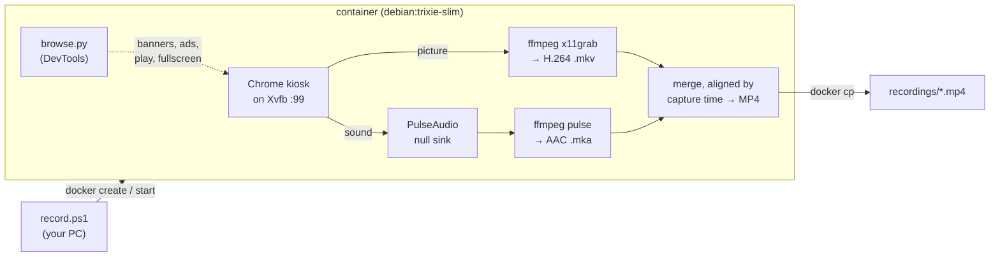

# play-action

**Record any web page, with sound, to an MP4: Chrome runs full-screen inside Docker, and you get a smooth 60 fps video file.**


[](LICENSE)

```powershell
.\record.ps1 https://www.youtube.com/watch?v=... -DurationMin 90 -Title "Interview"
```

It records a live stream, a TV player, a YouTube video or a dashboard, and you can keep using your PC while it runs. Nothing runs in your own browser.

---

## Contents

- [Features](#features)
- [Requirements](#requirements)
- [Quick start](#quick-start)
- [Options](#options)
- [What happens on the page](#what-happens-on-the-page)
- [Audio only](#audio-only--audio)
- [Logged-in pages](#logged-in-pages--cookies)
- [File size and compression](#file-size-and-compression)
- [How it works](#how-it-works)
- [Recording on a remote server](#recording-on-a-remote-server)
- [Using the image directly](#using-the-image-directly-docker)
- [Output](#output)
- [Known limits](#known-limits)
- [Troubleshooting](#troubleshooting)
- [License](#license)

## Features

- 🎥 **Smooth video:** 60 fps by default (`-Fps 50` for European TV). Picture and sound are captured by separate processes, so the video never stalls while the page is silent.
- 🔊 **Sound in sync:** both tracks carry their capture time and are lined up to within about 40 ms.
- 🍪 **Cookie banners closed for you:** it knows 13 common banner tools and falls back to finding a "Reject"/"Accept" button in six languages.
- ▶️ **Players started for you:** on YouTube it skips the consent screen, waits out ads, picks the original audio track, turns subtitles off, goes fullscreen and starts from 0:00. Players with a `.play-action` button (Shaka) are clicked and switched to fullscreen.
- 🔐 **Logged-in recording:** it can use cookies exported from your own browser.
- ⏱️ **Timed or open-ended:** `-Duration` (seconds), `-DurationMin` (minutes), or record until Ctrl+C. Stopping early keeps everything recorded so far.
- 🎧 **Audio only:** `-Audio` saves just the sound as AAC 256 kbit/s `.m4a`, pressing Spotify's play button for you.
- 🗜️ **H.265 by default:** each video is re-encoded after recording, 30–45 % smaller; `-NoCompress` skips it.
- 🧹 **Nothing left behind:** each run uses a fresh container, which is removed afterwards.

## Requirements

- **Docker** on an **amd64** machine; developed and tested on Windows with Docker Desktop. Chrome has no Linux arm64 build, so Apple Silicon Macs are not supported.
- **PowerShell** for `record.ps1`, either Windows PowerShell 5.1 or PowerShell 7. You can also run the image with plain `docker`, [see below](#using-the-image-directly-docker).
- Roughly **3.5 CPU cores** for 1080p at 50–60 fps.

## Quick start

```powershell
git clone https://github.com/sroziewski/play-action.git
cd play-action
Set-ExecutionPolicy -Scope CurrentUser RemoteSigned       # once, if scripts are blocked

.\record.ps1 https://example.com -Duration 30      # 30 seconds
.\record.ps1 https://example.com -DurationMin 90   # 90 minutes
.\record.ps1 https://example.com                   # until Ctrl+C
.\record.ps1 -Help                                 # full usage guide
```

The first run builds the Docker image, which takes a few minutes. After that a recording starts in seconds.

Videos are saved to `.\recordings\` under the folder you run the command from. While recording, a single status line keeps you informed:

```text
Recording https://example.com at 1920x1080 60 fps, 30 s
  REC 00:12 / 00:30  (00:18 left)
  browse: cookie banner (reject): clicked #onetrust-reject-all-handler
Saved D:\...\recordings\recording-20261023-100201-f935.mp4 (1.2 MB)
```

## Options

`.\record.ps1 -Help` (or `-h`) prints the full guide. `Get-Help .\record.ps1 -Full` gives the standard PowerShell help.

### What to record

| Option | Default | Meaning |
|---|---|---|
| `<Url>` | *(required, first argument)* | Page to open: `http://`, `https://` or `file://` |
| `-Duration <s>` | *(until Ctrl+C)* | Seconds to record, 1–86400 |
| `-DurationMin <m>` | *(until Ctrl+C)* | The same in minutes, up to 1440, fractions allowed (`1.5` = 90 s). Not together with `-Duration` |
| `-Warmup <s>` | `3` | Extra seconds to wait before recording, 0–600. They count after the page is ready (cookie banner handled, YouTube ads over) |

### Where to save

| Option | Default | Meaning |
|---|---|---|
| `-Dir <folder>` | `.\recordings` | Folder to save in, relative to the current folder or absolute; created if missing |
| `-Title <name>` | `recording-<timestamp>-<id>` | File name without extension, saved as `<Dir>\<name>.mp4` |
| `-Output <path>` | | Full path of the MP4 instead. Not together with `-Dir` or `-Title` |

An existing file of the same name is overwritten.

### Picture

| Option | Default | Meaning |
|---|---|---|
| `-Width <px>` | `1920` | Video width, an even number from 16 to 7680 |
| `-Height <px>` | `1080` | Video height, an even number from 16 to 4320 |
| `-Fps <n>` | `60` | Frames per second, 1–120. 60 suits 30 and 60 fps videos (most of YouTube). **Use `50` for 25/50 fps sources** such as European TV, or the video judders |

### Page handling

| Option | Default | Meaning |
|---|---|---|
| `-CookieBanner <x>` | `reject` | `reject` optional cookies, `accept` (for pages that only work after accepting), or `keep` to leave the banner alone |
| `-Cookies <file>` | | `cookies.txt` or JSON exported from your browser, so the page opens logged in ([details](#logged-in-pages--cookies)) |
| `-KeepPage` | off | Record the whole page instead of making the video fullscreen |

### Compression

| Option | Default | Meaning |
|---|---|---|
| `-NoCompress` | off | Skip the H.265 pass and keep the H.264 recording. Video is compressed by default; `-Compress` is still accepted |
| `-Crf <0-51>` | `26` | H.265 quality: lower means better and bigger. 28 is fine for talking heads |
| `-Preset <name>` | `medium` | `ultrafast` … `veryslow`. Slower presets give smaller files |
| `-KeepOriginal` | off | Also keep the H.264 file as `<name>.h264.mp4` |

### Audio only

| Option | Default | Meaning |
|---|---|---|
| `-Audio` | off | Record only the sound, to `<name>.m4a` or `<name>.mp3` ([details](#audio-only--audio)) |
| `-AudioFormat <f>` | `m4a` | `m4a` (AAC) or `mp3`. Only with `-Audio` |
| `-AudioBitrate <k>` | `256` (m4a), `320` (mp3) | Bitrate in kbit/s: `128`, `160`, `192`, `224`, `256`, and `320` for mp3 only. Only with `-Audio` |

### Docker

| Option | Default | Meaning |
|---|---|---|
| `-Image <name>` | `chrome-rec` | Docker image to run |
| `-Build` | off | Rebuild the image after editing `Dockerfile`, `browse.py` or `entrypoint.sh`. A missing image is built automatically |

### Examples

```powershell
# One hour of a 50 fps TV stream, with a readable file name, into D:\videos\tv
.\record.ps1 https://tv.example/live -Fps 50 -DurationMin 60 -Dir D:\videos\tv -Title "news 23-10"

# A YouTube video, kept as the H.264 recording (no H.265 pass, done right away)
.\record.ps1 "https://www.youtube.com/watch?v=..." -NoCompress

# A members-only page, logged in with your own cookies
.\record.ps1 https://site.com/page -Cookies .\site-cookies.txt -DurationMin 10

# 720p, the whole page rather than the fullscreen player
.\record.ps1 https://example.com -Width 1280 -Height 720 -KeepPage -Output D:\vids\demo.mp4

# sound only, logged in; on an album or playlist the length comes from the track list
.\record.ps1 https://example.com/... -Audio -Cookies .\cookies.txt -Title album
```

## What happens on the page

The tool drives Chrome over the DevTools protocol (`browse.py`) before and during the recording. The `browse:` lines printed at the end of a run say what it did.

### YouTube

For `youtube.com/watch`, `/shorts`, `/live` and `youtu.be` links:

| Step | |
|---|---|
| Consent | The "Before you continue to YouTube" screen is pre-accepted |
| Ads | Waited out, for up to 2 minutes |
| Audio | The video's **original** audio track, not an auto-dub in Chrome's language |
| Picture | Subtitles off; fullscreen unless `-KeepPage` |
| Start | Rewound to 0:00 and started about a second into the recording, so the opening isn't missed |

If YouTube asks you to "confirm you're not a bot" (it does this for some IP addresses), the page is recorded as it is.

### Cookie banners

On pages other than YouTube, once the page has loaded, the tool keeps looking for a banner for up to 12 s, because banners often appear late. Pages without a banner take that much longer to start.

- **Known banner tools:** OneTrust, Cookiebot, Didomi, cookieconsent, CookieYes, Complianz, Usercentrics, Quantcast, Google Funding Choices, TrustArc, Klaro, iubenda, CookieScript.
- **Any other banner:** it presses a button labelled like "Reject" or "Accept" in Polish, English, German, French, Spanish or Italian. It only does this when the button sits in a box that floats over the page and mentions cookies or privacy, so newsletter forms and other buttons are left alone.
- **Not reachable:** banners inside a separate frame (some Sourcepoint and TrustArc setups) stay on screen.

Chrome's own "Translate this page?" popup is switched off everywhere.

### Players with a play button

On other pages, about a second into the recording, the tool clicks the first match of `.play-action .podp`, `.play-action` or `.glownybutton.play`. It uses a real mouse click, because players ignore script clicks, and waits up to 10 s for the button to appear. Then, unless you pass `-KeepPage`, it presses the player's fullscreen button (`.shaka-fullscreen-button`).

This happens on camera, so the first seconds show the page and Chrome's "press Esc to exit full screen" notice. The log says `clicked the play button`, `no play button on the page`, or names the element that covers the button.

## Audio only (`-Audio`)

`-Audio` records just the page's sound. Nothing goes fullscreen and no video is encoded, so it needs very little CPU.

```powershell
.\record.ps1 https://example.com/... -Audio -Cookies .\cookies.txt -Title album
```

1. The page opens exactly as in video mode, with the same cookies and cookie banner handling.
2. Recording starts, and the tool then presses Spotify's play button with a real mouse click:
   - On an album, playlist, track, artist or podcast page, it uses the page's own big green button, so what the URL shows is played.
   - Elsewhere, it uses the bottom-bar play/pause toggle (`[data-testid="control-button-playpause"]`), which resumes whatever the account played last.
   - On other sites it uses a `.play-action` button; on YouTube it simply starts the video.

   Because recording starts first, the file opens with a moment of silence; the other way round, the start of the track would be lost.
3. Spotify labels these buttons with what a click would do, so **"Pauza"/"Pause" means it is already playing**. The tool then leaves the button alone, because a click would stop the music.
4. After clicking, it checks that playback really started. The log says `playback started`, `already playing`, that the page reports a DRM error, or that playback didn't seem to start.

| | |
|---|---|
| Format | AAC-LC in `.m4a` (default) or MP3 (`-AudioFormat mp3`, LAME, constant bitrate), 44.1 kHz stereo (Spotify's own sample rate, so nothing is resampled) |
| Bitrate | m4a: 256 kbit/s by default (about 1.9 MB per minute), `-AudioBitrate` 128–256. mp3: 320 kbit/s by default (about 2.4 MB per minute), 128–320 |
| Length | **Automatic on a Spotify album or playlist**: the track list's times added up, see below. Otherwise `-Duration` / `-DurationMin`, or until Ctrl+C. Stopping keeps everything so far |
| Not with | `-Compress`, `-KeepOriginal` (they re-encode video; audio is never re-encoded). `-Output` must end in `.m4a`, or `.mp3` with `-AudioFormat mp3` |
| If saving fails | m4a: the raw capture is kept next to it as `<name>.aac`. mp3: the capture is already the final file and is saved as such |

**Automatic length.** On an album or playlist page, without `-Duration`/`-DurationMin`, the tool records exactly the album:
- **Total:** it scrolls through the whole track list (Spotify only renders the rows on screen) and adds up every track's time. It only trusts the sum when it has read as many tracks as the list says it has.
- **Rounding:** the list shows each time rounded down to the second; that 24-track album sums to 54:00 but really lasts 54:12. On albums the tool uses the header's exact total ("54 min 12 sec") when it fits the rounding. On playlists, whose header only says "about 2 hr 45 min", it counts each track as 1 s longer, the worst case.
- **Margin:** it records that total plus 5 s, plus 0.25 s per track for start-up and buffering. For the 24-track, 54:12 album that is 54:23. Multi-disc "Disc N" headings are not counted as tracks.
- **From the top, in order:** it pauses playback during the warm-up and switches shuffle and repeat off. This changes the setting on your account, just as clicking them in the app would. When recording begins, it starts **track 1 from 0:00**.
- **Countdown:** the status line counts down (`REC 01:12 / 54:23`), and the log says `track list: 24 tracks, 54:12; recording 54:23 from the first track`.
- **Fallback:** if no complete list is found (track, artist and podcast pages, or another site), it records until Ctrl+C as before. Ctrl+C or an explicit `-Duration` always takes precedence.

**Which format:** `m4a` keeps Spotify's own codec, AAC, so it is the smaller file for the same quality. `mp3` plays on anything, including old players and car radios.

**Why these bitrates:** Spotify's web player streams AAC at up to 256 kbit/s on Premium and 128 on Free, and it can't be set higher.
- **m4a:** 256 keeps everything the stream carries. There is no 320 for m4a, because the image's AAC encoder (ffmpeg's own) spends at most about 265 kbit/s on 44.1 kHz stereo.
- **mp3:** MP3 is a less efficient codec than AAC and the audio is re-encoded from it, so its default is 320, which LAME really delivers.
- **Spoken word or a Free account:** 128 is enough.

**Spotify notes:**
- **Login:** you have to be logged in. Export your cookies from open.spotify.com (the login cookie is `sp_dc`) and pass them with `-Cookies`.
- **One device at a time:** Spotify plays on only one device at a time. If the account is playing on your phone, the desktop app or another browser, the recorder's page would only be a remote control and the file would be silent. So before recording, the tool opens Spotify's device picker and switches playback to "This web browser" (`moved Spotify playback from "…" to this browser` in the log). **This stops the music on your other device** for as long as the recording runs.
- **Proof of sound:** after the click the tool checks that sound really reaches the recorder. If none arrives, the log says `no sound is reaching the recorder` instead of a misleading "playing".
- **DRM:** playback needs Chrome's built-in Widevine DRM, which the image includes. If the page says protected content is disabled, the log reports it and the file will be silent.
- **Terms:** Spotify's terms don't allow copying its content, so keep recordings to your own private use.

The first `-Audio` run with an image built before this feature rebuilds it automatically.

## Logged-in pages (`-Cookies`)

Chrome in the container starts with an empty profile. To record a page as you see it when logged in:

1. Install a cookie export extension in your normal browser, e.g. **Get cookies.txt LOCALLY** or **Cookie-Editor**.
2. Open the site while logged in and export its cookies, either as Netscape `cookies.txt` or as JSON.
3. Record: `.\record.ps1 https://site.com/page -Cookies .\site-cookies.txt`

The run reports `browse: loaded N cookies for M sites`. Expired cookies are skipped.

> [!WARNING]
> **The cookies file is a login.** Anyone who has it can use your account. Keep it out of shared folders and git (`.gitignore` here already excludes `*cookies*.txt` and `*cookies*.json`), and delete it when you're done. The tool copies it into the container rather than mounting it, never logs cookie values, and removes it together with the container.

Some sites tie a session to your device and will ask you to sign in again; Google accounts do this. Sessions also expire as they do in your browser. If recordings show the login page, export fresh cookies.

## File size and compression

| Content | H.264 recording (`-NoCompress`) |
|---|---|
| Busy 1080p30 video (YouTube interview) | about 7.5 MB/min, 650–700 MB per 90 min |
| Static web page | a few hundred KB/min |

These figures were measured at 30 fps. At the default 60 fps, busy video produces larger files; this hasn't been measured yet. `-Fps 30` returns to the sizes above.

By default the finished video is re-encoded to H.265 on all CPU cores Docker can see. It is **30–45 % smaller** but slow: about 1–2.5 minutes per minute of video on a 12-thread PC, so roughly 1.5–4 hours for a 90-minute recording. If you press Ctrl+C or the compression fails, you keep the H.264 file. You also keep it when H.265 comes out bigger, which can happen with static pages. `-NoCompress` skips the pass and saves the H.264 file right away.

## How it works



1. `record.ps1` creates a container, copies in the cookies file if you gave one, and starts it.
2. `entrypoint.sh` starts PulseAudio with a virtual speaker, an Xvfb virtual screen, and Chrome in kiosk mode.
3. `browse.py open` handles cookies, the banner and YouTube. Then `-Warmup` seconds pass.
4. Two ffmpeg processes record the screen and the speaker, each stamping data with the wall-clock time. One second in, `browse.py play` starts the video.
5. When the time is up, or on Ctrl+C (`docker stop`), both captures finish and are merged into one MP4. The tracks are lined up by their capture times without re-encoding, which takes a few seconds even for long recordings.
6. `record.ps1` copies the MP4 out, prints what `browse.py` did, and removes the container.

Picture and sound are deliberately recorded by separate processes. In a single ffmpeg process the screen grab paused whenever sound arrived late (at the start and while the page was silent), and the video repeated frames, dropping as low as 3 new frames per second.

## Recording on a remote server

`deploy-play-action.ps1` runs the same recording on a Linux server over SSH. It takes every option of `record.ps1`, with the same names and checks, plus the connection:

```powershell
.\deploy-play-action.ps1 https://example.com/... -Audio -Cookies .\cookies.txt -Ip 203.0.113.7 -User me -Key ~\.ssh\id_ed25519 -Port 22
```

| Option | Meaning |
|---|---|
| `-Ip`, `-User`, `-Key`, `-Port` | **Required.** Server address, login, private key file, SSH port |
| `-Setup` | Install what's missing on an **Ubuntu** server first (needs passwordless sudo), see below. Alone or together with a recording |
| `-Detach` | Start and return at once |
| `-Attach` | Follow the latest recording again, and download it when it ends |
| `-Stop` | End the latest recording early, as Ctrl+C would; what was recorded is still saved and downloaded |
| `-Run <id>` | With `-Attach`/`-Stop`: that recording instead of the latest (the id is printed when it starts) |
| `-NoDownload` | Leave the finished file on the server only |
| `-LocalDir <folder>` | Where downloads go (default `.\recordings`) |
| `-RemoteDir <path>` | Folder on the server (default `play-action` in the login's home) |
| `-Repo <url>` | Repository to clone on the server (default this public one) |
| `-MaxImageAgeDays <n>` | Rebuild the server's Docker image once it is older (default 30) |

**First time on a fresh Ubuntu server**, install everything once:

```powershell
.\deploy-play-action.ps1 -Setup -Ip 203.0.113.7 -User me -Key ~\.ssh\id_ed25519 -Port 22
```

`-Setup` runs `sudo -n`, so it needs a login with passwordless sudo, and it only installs what is missing:
- **Packages:** git, screen and curl.
- **Docker CE** from Docker's own repository. A snap Docker is removed first, because it is sandboxed and can't build or copy files in most folders.
- **PowerShell 7** from Microsoft's repository.
- **Docker access:** your login is added to the `docker` group.
- **Keeping recordings alive through upgrades:** unattended upgrades skip Docker, needrestart doesn't restart containerd, and Docker's `live-restore` keeps containers running across a patch-level daemon restart. An upgrade of Docker would otherwise restart every container and end a running recording.

What every run does:
1. **Checks the server:** Linux x86_64, git, and Docker usable by the login.
2. **Sets it up:** clones this repository into `~/play-action` on the first run and pulls updates afterwards. If the server has no PowerShell, it fetches a portable PowerShell 7 into `~/.play-action`, without sudo.
3. **Checks the disk:** it refuses to start with less than 3 GB free, or 5 GB when the image has to be built, both where recordings are saved and in Docker's storage.
4. **Keeps the image current:** it rebuilds the Docker image when the pulled code changed it, or when it is older than 30 days. Chrome and its DRM module need updates to keep playing Spotify.
5. **Uploads the `-Cookies` file** into a private folder (`~/.play-action/cookies`). The file is deleted again when the recording ends, and leftovers older than a day are purged.
6. **Starts `record.ps1`** in a `screen` session named `play-action-<id>`:
   - The recording keeps running if your connection drops.
   - To watch it on the server: SSH in, run `screen -r play-action-<id>`, and detach again with Ctrl+A, D.
   - The session closes by itself once the file is saved. The file stays in the server's `recordings` folder, or wherever `-Dir`/`-Output` point.
   - Without `screen` on the server, it runs as a plain background process.
7. **Follows the progress** in your terminal and **downloads the file** when it's done. Ctrl+C here only stops following and prints how to resume.

**If the connection drops**, or you stopped following, the recording carries on on the server. The script prints the recording's id; use it to follow again and download the file. That works while it is still recording and after it has finished:

```powershell
.\deploy-play-action.ps1 -Attach -Run 20261024-115546-31e7 -Ip 203.0.113.7 -User me -Key ~\.ssh\id_ed25519 -Port 22
```

To end it early, for example when the film is over before `-Duration` runs out (what was recorded is saved and downloaded):

```powershell
.\deploy-play-action.ps1 -Stop -Run 20261024-115546-31e7 -Ip 203.0.113.7 -User me -Key ~\.ssh\id_ed25519 -Port 22
```

Without `-Run`, both act on the latest recording.

Notes:
- **Server requirements:** your login must be allowed to use Docker; `-Setup` handles that, otherwise run `sudo usermod -aG docker <login>`. The first run builds the Docker image, which takes a few minutes.
- **Where the server is matters:** a datacenter IP in another country can make Spotify ask you to log in again or hide region-locked albums, and YouTube shows its "confirm you're not a bot" page more often to such IPs.
- **Paths:** `-Dir` and `-Output` name paths on the server, relative to its `play-action` folder.
- **Code version:** the server runs the code **pushed to GitHub**, not your local edits.
- **Host key:** it is trusted the first time you connect (`StrictHostKeyChecking=accept-new`).
- **Key permissions:** if ssh says the key file's permissions are too open, the script prints the `icacls` command that fixes them.

## Using the image directly (`docker`)

```sh
docker build -t chrome-rec .

# 30 seconds into the "rec" volume
docker run --rm --shm-size=2g -v rec:/out -e URL=https://example.com -e DURATION=30 chrome-rec

# or straight into a host folder (the container runs as uid 1000 and needs write access)
docker run --rm --shm-size=2g -v "$PWD/out:/out" -e URL=https://example.com -e DURATION=30 chrome-rec
```

`--shm-size=2g` gives Chrome enough shared memory; without it, tabs can crash.

To record until you stop it, leave out `DURATION` and run detached:

```sh
docker run -d --name rec1 --shm-size=2g -v rec:/out -e URL=https://example.com chrome-rec
docker stop -t 120 rec1     # the long timeout gives the merge time to finish
docker rm rec1
```

While recording, picture and sound are written to `recording.video.mkv` and `recording.audio.mka` next to the output. Both stay playable if the container is killed before the merge, and they are deleted once `recording.mp4` exists.

To get a file out of the volume:

```sh
docker create --name tmp -v rec:/out alpine
docker cp tmp:/out/recording.mp4 .
docker rm tmp
```

### Environment variables

| Variable | Default | Meaning |
|---|---|---|
| `URL` | `https://example.com` | Page to open |
| `WIDTH` / `HEIGHT` | `1920` / `1080` | Video size; the page is rendered at this size |
| `FPS` | `60` | Frames per second the screen is grabbed at |
| `DURATION` | *(empty)* | Seconds to record; empty means until the container stops |
| `WARMUP` | `3` | Seconds to wait after the page is ready |
| `YT_FULLSCREEN` | `1` | `1` makes the video fullscreen (YouTube, play-button players), `0` keeps the page |
| `COOKIE_BANNER` | `reject` | `reject`, `accept` or `keep` |
| `COOKIES` | *(empty)* | Path of a cookies file inside the container |
| `OUT` | `/out/recording.mp4` | Output file inside the container, overwritten on each run |
| `AUDIO_ONLY` | `0` | `1` records only the sound (see `AUDIO_FORMAT`; name `OUT` to match) |
| `AUDIO_BITRATE` | `256` | Bitrate in kbit/s for `AUDIO_ONLY=1` |
| `AUDIO_FORMAT` | `m4a` | `m4a` (AAC) or `mp3`; name `OUT` to match |

## Output

- H.264 video (libx264 `veryfast`, CRF 23) and AAC 128 kbit/s audio. The recorder writes a fragmented MP4. After the default H.265 pass the file is H.265 (libx265 `medium`, CRF 26) in a regular MP4 with the index at the front; with `-NoCompress` it stays the H.264 one.
- The audio track is there even when the page is silent.
- Page sound plays automatically; no click is needed.
- With `-Audio`: an `.m4a` (AAC) or `.mp3` with the sound only, see [Audio only](#audio-only--audio).
- The mouse pointer is not recorded.

## Known limits

- **CPU:** rendering and encoding run in software. 1080p at 50 fps takes about 3.5 cores (encoding about 2.5). The virtual display renders only in software, so a GPU wouldn't help. On small machines, lower `-Fps` or the size.
- **Smoothness:** the screen is grabbed at a fixed rate, so a source whose frame rate doesn't divide into it judders. For example, 25 fps TV recorded at the default 60 fps shows each frame for alternately 2 and 3 grabs; use `-Fps 50` for such sources. Frames keep the time they were grabbed at, so the frame rate is nominally rather than exactly constant; players don't mind.
- **Audio sync:** within about ±40 ms. The file ends with the shorter track, so a timed recording can come out a fraction of a second shorter than asked.
- **Audio failure:** if sound can't be captured at all, the video is saved without it. If sound capture fails midway, the recording stops there and keeps what was captured, sound included up to that point.
- **Fonts:** Asian and Arabic text shows as boxes. Add `fonts-noto-cjk` (or the font you need) to the `apt-get install` line in the `Dockerfile`.
- **Format:** the output is always MP4, whatever extension `OUT` has.
- **Sandbox:** Chrome runs with `--no-sandbox`, because Docker's default seccomp profile blocks Chrome's sandbox. The container is the isolation boundary, so only open pages you trust.

## Troubleshooting

| Symptom | What to do |
|---|---|
| `docker build failed` / `500 Internal Server Error … _ping` | Docker Desktop's engine isn't running or has crashed. Restart Docker Desktop |
| The video judders on a TV stream | Use `-Fps 50` for 25/50 fps sources |
| The recording shows a login page | Export fresh cookies (`-Cookies`). Some sites don't accept cookies from another device |
| The cookie banner stays on screen | Banners inside a frame (Sourcepoint, some TrustArc) can't be reached. Use `-Cookies` with an export from a browser where you already answered the banner. `-CookieBanner accept` only helps when the banner has no reject button |
| `running scripts is disabled on this system` | Run `Set-ExecutionPolicy -Scope CurrentUser RemoteSigned` once, or start with `powershell -ExecutionPolicy Bypass -File .\record.ps1 ...` |
| `no play button on the page` | The player uses different markup. Record with `-KeepPage` and start the video another way |
| The first seconds show the page, not the video | Expected: the play and fullscreen clicks happen on camera |
| `No recording was produced` | You stopped during warm-up, or the recorder failed. The last 30 log lines are printed |
| Changes to `browse.py` or `entrypoint.sh` don't apply | Add `-Build` |

## License

[MIT](LICENSE) © 2026 Szymon Roziewski. Google Chrome, ffmpeg and the other packages installed into the Docker image keep their own licenses.
